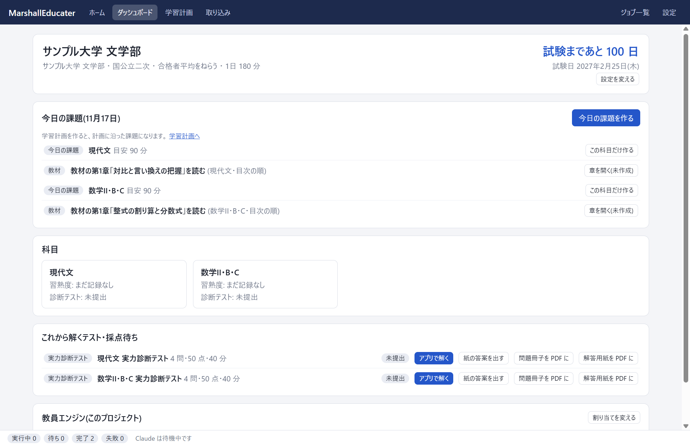
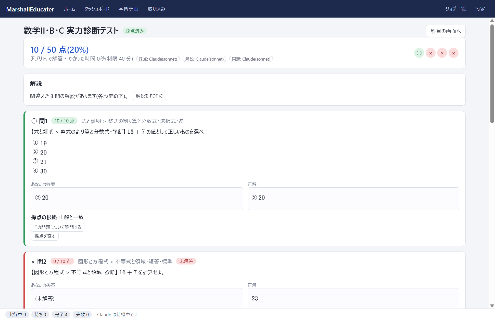
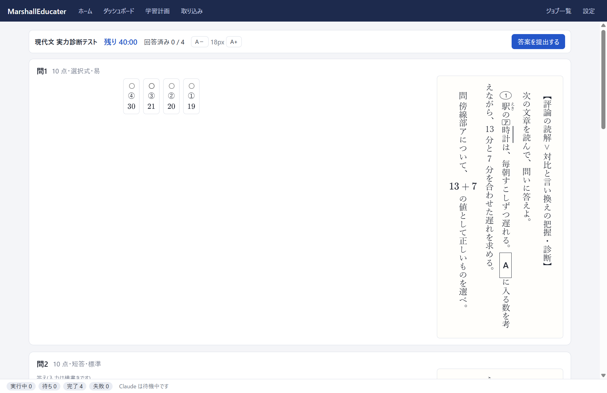
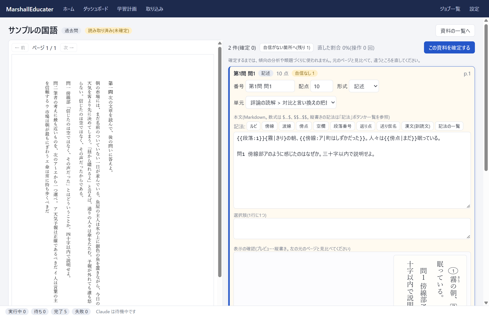
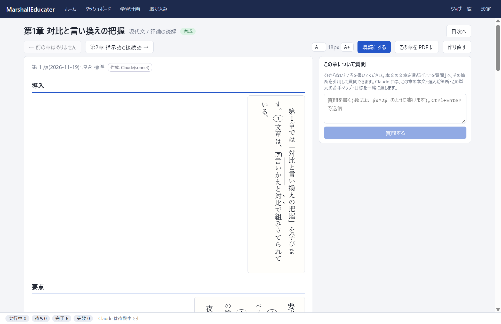

# MarshallEducater

**AI を教員にする、大学受験の勉強用の Windows デスクトップアプリです。**「Claude だけで大学受験ができるか」を試すために作っています。

実力診断テストの作成・出題、答案(手書きのスキャンも)の読み取り、採点、苦手の分析、学習計画、毎日の課題、解説、質問への回答、教科書代わりの教材づくりまで、**教える側の仕事はすべて AI が行います**。アプリは画面とファイルの管理、AI の呼び出しだけを受け持ちます。教員役の AI(教員エンジン)は Claude(Claude Code)が既定で、ChatGPT(Codex CLI)・Gemini(Gemini CLI)も選べます。



## できること

- **プロジェクト** … 志望校(大学・学部)、試験日、試験の型、目標の高さ、科目、1日に使える時間を決めます。
- **実力診断テスト** … 科目ごとに AI が作ります。作った問題は **別の呼び出しで解答を見せずに解き直して検算** し、答えが一致したものだけを使います。
- **解く** … アプリの中で制限時間つきで解くか、問題冊子・解答用紙を PDF に出して紙で解き、スキャン・撮影して取り込みます。
- **読み取りと補正** … AI が答案や過去問の PDF を読み取り、元の画像と並べて人が直して確定します。
- **採点・苦手マップ** … 部分点・ミスの種類(知識不足・計算ミスなど)・所見つきで採点し、単元ごとの習熟度を更新します。採点は上書きできます。
- **学習計画と今日の課題** … 試験日から逆算した週ごとの計画と、苦手克服・過去問の類題・復習の課題。
- **解説と質問** … 間違えた問題ごとの解説。問題・解説・教材のどこからでも質問できます。
- **体系的な教材** … 単元ツリーの順に、習熟度に合わせた厚さで章を作ります(例題・確認問題は検算、本文は別の呼び出しで点検)。
- **国語は縦書き** … 本文・設問・選択肢・教材・PDF を本番と同じ縦書きで表示・印刷します。ルビ・傍線・空欄・漢文の返り点・送り仮名にも対応しています。

| 採点結果(数式は KaTeX) | 国語は縦書きで解く |
| --- | --- |
|  |  |

| 読み取りの補正(左が元のページ) | 教材の章と質問欄 |
| --- | --- |
|  |  |

(画像は自動テスト用の偽の AI と、ダミーのデータで撮ったものです。)

## 必要なもの

- Windows 10 / 11
- **[Claude Code](https://claude.com/claude-code)**(`claude` コマンド)。入れたあと、ターミナルで `claude` を起動し、`/login` でログインしておきます。アプリはあなたのログインのまま Claude Code を呼び出します。**アプリは API キーを預からず、保存もしません。**
- 任意: ChatGPT を使うなら [Codex CLI](https://github.com/openai/codex)(`npm i -g @openai/codex` → `codex login`)、Gemini を使うなら Gemini CLI。入っていなくても、Claude だけで全部動きます。
- ソースから動かす場合: Node.js 22 以上、Git(Git Bash)

## 入れ方

### インストーラ(おすすめ)

1. GitHub の [Releases](https://github.com/dvyozakura/MarshallEducater/releases) から `MarshallEducater-Setup-<版>.exe` をダウンロードして実行します。
2. 管理者の権限は要りません(ユーザーごとに入ります)。入れる場所を選べ、スタートメニューとデスクトップにショートカットができます。
3. **初回は Windows の警告(「Windows によって PC が保護されました」)が出ます。** このアプリはコード署名をしていないためです。「詳細情報」→「実行」で進めます。心配な場合は、下の「ソースから」でビルドしてください。
4. アンインストールは「設定 → アプリ」から。**学習データ(ドキュメント/MarshallEducaterData)は消えません。** 上書きインストール(新しい版を入れる)でも、設定とデータはそのまま残ります。

### ソースから

```bash
git clone https://github.com/dvyozakura/MarshallEducater.git
cd MarshallEducater
./Tools/setup.sh        # 依存の導入と、node・git・claude(と任意の codex)の点検
npm start               # ビルドして起動
./Tools/build_dist.sh   # インストーラ無しの配布用フォルダ(dist/)を作る
npm run installer       # インストーラ(release/MarshallEducater-Setup-<版>.exe)を作る
```

## 最初の使い方

1. **プロジェクトを作る** … ホームの「新しいプロジェクト」で、大学名・学部、試験日、試験の型、目標の高さ、科目、1日に使える時間を入れます。
2. **実力診断テストを作る** … ダッシュボードの案内から。AI が問題を作り、別の呼び出しで解き直して検算します(数分かかります。待っている間もほかの画面を使えます)。
3. **解く** … 「アプリで解く」か、問題冊子と解答用紙を PDF に出して紙で解き、スキャン・撮影したものを「紙の答案を出す」から取り込みます。
4. **読み取りを確かめる**(紙の場合) … 補正画面で、AI の読み取り結果を元の画像と見比べて直し、「確定」します。
5. **採点と解説を読む** … 部分点・ミスの種類・所見と、間違えた問題ごとの解説(考え方 → 解き方 → 同じミスを防ぐ一言)が出ます。
6. **苦手マップと学習計画** … 科目の「苦手マップ」で単元ごとの習熟度を見て、「学習計画」で週ごとの計画を作ります。
7. **今日の課題** … ダッシュボードの「今日の課題を作る」。解いて提出すると苦手マップが更新されます。
8. **過去問を取り込む** … 自分で用意した過去問の PDF を「取り込み」から入れて補正・確定すると、志望校の出題傾向がまとまり、類題づくりに使われます。
9. **教材を読む・質問する** … 科目の「教材」タブで章を作って読み、分からない文を選んで「ここを質問」。

国語の科目は自動で縦書きになります(科目のページの「科目の設定」で変えられます。記法の一覧と見本もそこにあります)。

## データの置き場所

- 既定は `ドキュメント/MarshallEducaterData/<プロジェクト名>/`(設定画面で変えられます)。
- 中身はすべて普通のファイル(JSON・Markdown・PNG・PDF)です。そのフォルダを Claude Code で直接開いて相談することもできます。
- AI の呼び出しの記録(プロンプト・所要時間・結果)は、各プロジェクトの `logs/` に残ります。
- アプリの設定は `%APPDATA%\MarshallEducater`(Electron の userData)にあります。

## 困ったとき

- 「見つかりません」→ Claude Code(や Codex CLI)を入れるか、設定画面の「場所」に実行ファイルの場所を入れます。設定画面の「教員エンジン」に、探した場所が出ます。
- 「ログインしていません」→ ターミナルで `claude` を起動して `/login`(Codex は `codex login`)。
- 「使用量の上限に達しました」→ 上限が戻る時刻まで待ってから「もう一度試す」。
- 1日の呼び出し回数には上限(既定 200 回)があります。設定画面で変えられます。

## 開発

| スクリプト(Git Bash) | 内容 |
| --- | --- |
| `./Tools/setup.sh` | 依存の導入と環境の点検 |
| `./Tools/run_tests.sh` | 型チェック+単体テスト(Vitest) |
| `./Tools/run_e2e.sh` | 偽の AI での自動操作テスト(Playwright で Electron を起動) |
| `./Tools/build_dev.sh` | 開発ビルド(`out/`) |
| `./Tools/build_dist.sh` | 配布用フォルダ(`dist/`)の作成と起動確認 |
| `npm run installer` | Windows のインストーラ(`release/`)を作る |
| `./Tools/smoke_real.sh` | 本物の Claude を使う最小の確認(呼び出し5回まで。使用量を消費します) |
| `./Tools/check_logs.sh` | 直近のログからエラーを抜き出す |
| `npm run check:privacy` | 公開前の点検(個人情報らしき文字列・秘密の値を探す) |
| `npm run notices` | 依存ライブラリのライセンス一覧(`THIRD_PARTY_NOTICES.md`)を作り直す |

- 自動テストは、環境変数 `ME_FAKE_CLAUDE=1` で動く偽の AI(`Tools/fake-claude`)を使います。速く、無料で、結果が毎回同じです。
- 仕様は `CLAUDE.md`、決めたことの記録は `Docs/DECISIONS.md`、進み具合は `Docs/PROGRESS.md` にあります。
- 不具合の報告・開発への参加は [CONTRIBUTING.md](CONTRIBUTING.md) を見てください。

## 注意

- **このアプリは非公式のソフトウェアです。** Anthropic・OpenAI・Google とは関係がなく、各社が作ったり保証したりしているものではありません。Claude・ChatGPT・Codex・Gemini は各社の商標です。
- **過去問や教材は同梱していません。** 過去問・問題集などは、利用者が自分で正当に入手したものを取り込んでください。取り込んだ資料は、あなたの PC のデータフォルダにだけ置かれます。
- **AI が作る問題・採点・解説・教材には誤りがありえます。** 検算・点検の仕組みはありますが完全ではありません(特に漢文の返り点、図形、計算の長い問題)。大事な判断の前には、教科書や先生など信頼できる情報で確かめてください。
- **各 AI の利用規約と使用量は、利用者自身の契約に従います。** アプリはあなたのログインのまま各社のコマンドラインツールを呼ぶだけで、使用量(料金・回数の上限)はあなたの契約から消費されます。
- 無保証です(MIT ライセンス)。

## ライセンス

[MIT](LICENSE)(著作権者: ururuzawa)。使っているライブラリのライセンスは [THIRD_PARTY_NOTICES.md](THIRD_PARTY_NOTICES.md) にあります。

## いまは対象外

英語リスニングなど音声を使う科目、スマホ版、複数人での共有・クラウド同期、過去問そのものの同梱・配布。
